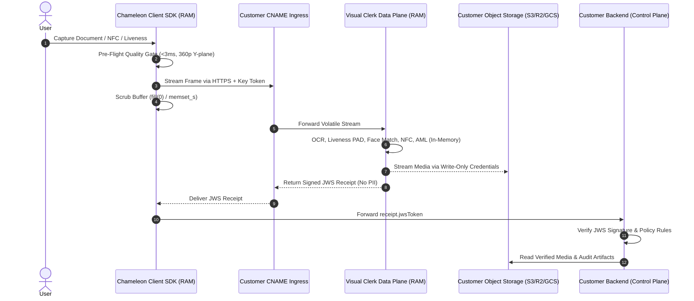

# System Architecture & Diskless Data Flow

Chameleon KYC and **MTCHSHIP Visual Clerk** separate capture, stateless biometric/document evaluation, and persistent storage into strict trust boundaries.

## End-to-End Sequence

## Trust Boundaries

* **Client Device (Volatile RAM):** Captures frames and NFC APDUs in pre-allocated buffers. No files are written to flash storage, SQLite, or IndexedDB. Buffers are scrubbed immediately upon network handoff.
* **Customer CNAME Edge:** Routes traffic under the customer's first-party domain, preserving TLS termination control and regional ingress routing.
* **Visual Clerk Data Plane (Diskless):** Executes verification models strictly in volatile memory. No disk volumes, databases, or multi-tenant buckets are attached to worker nodes.
* **Customer BYOS Bucket:** Receives media streams directly from Visual Clerk memory using scoped write-only IAM credentials or short-lived pre-signed URLs.
* **Customer Control Plane:** Retains sole ownership of user records, session state, and KYC approval logic by verifying the cryptographic `JWS` receipt.
